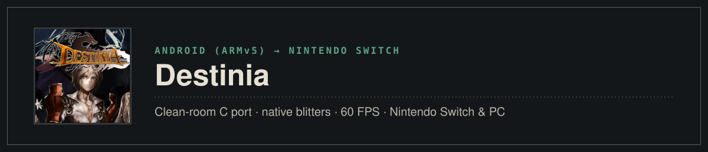
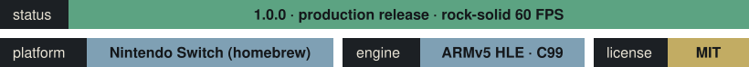

<p align="center">
  
</p>

<p align="center">
  <b>English</b> · <a href="README_RU.md">Русский</a>
</p>

<p align="center">
  
</p>

A native clean-room Nintendo Switch and PC port of the classic Action RPG **Destinia** (GAMEVIL, 2011, v1.06).
The game's ARMv5 Thumb engine (`libdestinia_jni.so`) runs directly through a lightweight C interpreter with High-Level Emulation (HLE) of Android and JNI platform services (framebuffer presentation, file I/O, audio streaming, input processing, and timing). Critical rendering hot spots (weapon blitters, aura effects, alpha blending, screen darkeners) are replaced with verified native C routines for optimal performance.

> [!IMPORTANT]
> **[Version 1.0.0](https://github.com/malinkin-s/destinia-nx/releases/tag/v1.0.0)** is the full production release. Tested on real Nintendo Switch hardware with rock-solid 60 FPS in combat, complete controller support, built-in video capture / SysDVR streaming, and an offline Gold economy. The game's assets are not included: you must provide your own legally acquired `DESTINIA_v1_06.apk` (installation instructions below).

## Status

**Version 1.0.0, 2026-10-25.** Measured on a Nintendo Switch at stock clocks (handheld, CPU 1020 MHz, GPU 384 MHz).

| Area | Switch | Notes |
|---|---|---|
| Boot, logos, menus | **Works** | Stable 60 FPS, menu tab switching via **L / R**, selected items highlighted |
| Story mode & exploration | **Works** | Smooth traversal, continuous walking after dashes and zone transitions |
| Combat & skills | **Works** | Rock-solid 60 FPS, 0 frame drops during critical strikes and skill effects |
| HUD & Controls | **Works** | Clean console layout, mobile touch buttons hidden, two-page **Hold L** hotbar |
| Saves on SD card | **Works** | Saved and loaded seamlessly to SD card storage |
| Audio & BGM | **Works** | SDL2_mixer hardware audio playback and background music |
| Video capture & SysDVR | **Works** | Native 30s video recording via Capture button (`video_capture = 2`) and SysDVR streaming |
| Special Shop & Revive | **Works** | Microtransactions replaced with in-game Gold, instant revive on death |
| Sleep mode (suspend/resume) | **Works** | Clean suspend to HOME menu and sleep mode with audio mute |

### What was solved to get here

- **Clean-room ARMv5 Thumb interpreter & HLE**: Runs the original 32-bit ARM engine binary on 64-bit Horizon OS (AArch64) and desktop x86_64 without Android virtualization overhead.
- **Bit-exact verified hot paths (`golden.sh`)**: All native replacements pass a 700-frame pixel-for-pixel regression test against the reference emulator (`PASS: 700/700 frames identical`).
- **Native rendering routines**: Hand-optimized C blitters (`Grp_drawWPNImage`, `_Grp_drawAura16`, `Grp_closeupScreen2`, `_Grp_drawDodgeCol16`) eliminate all frame-time spikes in heavy combat.
- **Console HUD overhaul**: Mobile touchscreen D-pad and virtual buttons hidden; quickslot arc redesigned into an ergonomic 10-slot gamepad hotbar with dynamic button glyphs (`[ZL], [Y], [X], [R], [ZR]` $\leftrightarrow$ `[L+ZL]..[L+ZR]`).
- **Seamless traversal**: Left analog stick direction automatically resumes walking after dashes and map transitions (`resume_walk`).
- **Offline Gold economy**: Network billing replaced with in-game Gold purchases ([docs/economy.md](docs/economy.md)), death revive made responsive and reliable.
- **Native video capture**: Added Switch NACP automatic gameplay recording permission (`0x02`), enabling SysDVR USB/network streaming and 30-second album capture.

## Screenshots

Captured directly on a Nintendo Switch (640×360), version 1.0.0.

<table>
  <tr>
    <td></td>
    <td></td>
  </tr>
  <tr>
    <td align="center"><sub>Title screen</sub></td>
    <td align="center"><sub>Mode select menu</sub></td>
  </tr>
  <tr>
    <td></td>
    <td></td>
  </tr>
  <tr>
    <td align="center"><sub>Combat with console hotbar</sub></td>
    <td align="center"><sub>Field battle</sub></td>
  </tr>
  <tr>
    <td></td>
    <td></td>
  </tr>
  <tr>
    <td align="center"><sub>World exploration</sub></td>
    <td align="center"><sub>Dungeon</sub></td>
  </tr>
  <tr>
    <td></td>
    <td></td>
  </tr>
  <tr>
    <td align="center"><sub>Story dialogue</sub></td>
    <td align="center"><sub>Character status & equipment</sub></td>
  </tr>
</table>

## Controls

### Field & Combat

| Input | Action |
| :--- | :--- |
| **Left Stick / D-Pad** | Move Hero / Navigate Menus |
| **A** | Confirm / Attack / Interact / Talk |
| **B** | Cancel / Character Menu (in field) |
| **Minus (-)** | Toggle Mini Map |
| **Plus (+)** | System Menu (Save / Settings) |
| **L / R** (character menu) | Switch between menu tabs |
| **Capture button** | Short press for screenshot, hold for 30s video recording |

### Quick Slots Hotbar

The quick slots use an intuitive two-page system. Hold **L** to shift to Page 2:

| Input | Page 1 (Neutral) | Page 2 (Holding L) |
| :--- | :--- | :--- |
| **ZL** | Quick Slot 5 (Potion / Consumable) | Quick Slot 10 (Consumable 2) |
| **Y** | Quick Slot 1 (Skill) | Quick Slot 6 (Skill) |
| **X** | Quick Slot 2 (Skill) | Quick Slot 7 (Skill) |
| **R** | Quick Slot 3 (Skill) | Quick Slot 8 (Skill) |
| **ZR** | Quick Slot 4 (Skill) | Quick Slot 9 (Skill) |
| **LS (L3 click)** | Quick Slot 5 (Direct access) | Quick Slot 10 (Direct access) |

## Installation & Running

### Requirements
- A Nintendo Switch running custom firmware (**Atmosphère** 1.0.0+).
- Legally acquired `DESTINIA_v1_06.apk` (Gamevil, 2011).

### Setup
1. Download the latest release from the [Releases](https://github.com/malinkin-s/destinia-nx/releases) page.
2. Extract the archive onto your microSD card so the directory structure looks like this:
   ```text
   sdmc:/switch/destinia/
   ├── destinia.nro
   └── DESTINIA_v1_06.apk
   ```

### Launching

You can run the game in two ways:

1. **Via Homebrew Menu**: Launch the Homebrew Menu (hold **R** while launching any installed game for full RAM access, or open Album) and select **Destinia**.
2. **Via HOME Menu Forwarder (Recommended)**:
   - Install `Destinia [0100D3571A000000] [v0].nsp` (or `.nsz`) using DBI, Tinfoil, TinWoo, or Sphaira.
   - Launch **Destinia** directly from the Nintendo Switch HOME menu.
   - When updating in the future, simply replace `destinia.nro` on your SD card.

## Building

### Nintendo Switch (.nro)

Building for Nintendo Switch uses Docker with devkitPro `devkitA64`:

```bash
# Clean build
./tools/build_switch.sh clean

# Build NRO (outputs to port/destinia.nro)
./tools/build_switch.sh -j$(nproc)

# Build forwarder NSP / NSZ
./tools/build_forwarder.sh

# Package release zip
./tools/package.sh 1.0.0
```

### PC (Linux / macOS)

Requirements: GCC/Clang, SDL2, zlib, libm.

```bash
# Build desktop binary
make -C port -j$(nproc)

# Run game
./port/destinia --apk DESTINIA_v1_06.apk
```

### Regression Tests (Golden Frames)

To verify pixel-exact emulation against the reference:

```bash
./port/tests/golden.sh DESTINIA_v1_06.apk
```

## Credits

- **Original Game**: GAMEVIL Inc. (now Com2uS Holdings).
- **Nintendo Switch Port & Reverse Engineering**: [malinkin-s](https://github.com/malinkin-s) and contributors.
- **Reference & Inspiration**: aks796 ([a8retry_nx](https://github.com/aks796/a8retry_nx), android32).
- **Libraries & Toolchains**: [devkitPro](https://devkitpro.org/) (devkitA64, libnx), [libSDL2](https://www.libsdl.org/), SDL2_mixer.

## License and disclaimer

MIT, see [LICENSE](LICENSE). This is a fan-made project and is **not** affiliated with, endorsed by, or sponsored by GAMEVIL, Com2uS Holdings, or Nintendo. *Destinia* and all related characters and trademarks belong to their respective owners. **No copyrighted game code, binary libraries, or assets are distributed in this repository.**
