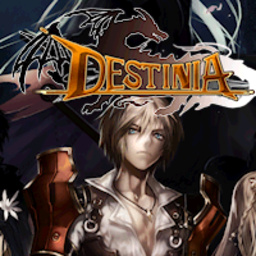

<div align="center">

<a href="icon.jpg"></a>

# destinia-nx

**Destinia для Nintendo Switch и ПК**

Неофициальный clean-room порт и слой совместимости для классической Action RPG 2011 года  
**Destinia** (Gamevil, v1.06).

[](#)
[](#)
[](#)
[](#)

[English](README.md) | **Русский**

</div>

---

## О проекте

`destinia-nx` — это нативный чистый (clean-room) C-порт и слой совместимости, выполняющий оригинальный ARM Thumb движок (`libdestinia_jni.so`) игры **Destinia** (v1.06, 2011, GAMEVIL) под Horizon OS на Nintendo Switch и на ПК (Linux/macOS).

Вместо медленных эмуляторов Android или виртуальных машин проект использует легковесный интерпретатор инструкций с высокоуровневой эмуляцией (HLE) платформенных служб Android и JNI (вывод кадрового буфера, файловая система, потоковый звук, обработка ввода и тайминги). Критические участки рендеринга (блиттинг оружия, альфа-смешивание, затемнение экрана) заменены на оптимизированные нативные C-функции.

**Данный репозиторий и его релизы не содержат игрового кода или ассетов.** Игрок должен предоставить собственную легально приобретённую копию `DESTINIA_v1_06.apk`. Нативная библиотека внутри APK проверяется при старте по контрольной сумме SHA-256 (`8464fc90edab73ee67bf8528aa1d40a5a2a229a888ca8c8a14e9fbc74640d829`).

---

## Особенности и улучшения для Switch

- **Стабильные 60 FPS**: Нативные C-блиттеры для отрисовки спрайтов (`Grp_drawWPNImage`, `Grp_drawWPNImage2`, `Grp_darkScreen`, `Grp_pxlMultiply`) полностью устраняют просадки FPS в городах и при открытии карты.
- **Новый консольный интерфейс (HUD)**: Полностью удалены мобильные виртуальные стики, D-pad и наэкранные кнопки при игре с геймпада.
- **Двухстраничный хотбар скиллов (Удержание L)**:
  - Неудобный мобильный круг слотов переработан в аккуратный горизонтальный хотбар в правом нижнем углу экрана.
  - Зажатие шифта **L** мгновенно переключает страницу между **слотами 1–5** и **слотами 6–10** с динамической сменой глифов кнопок (`[ZL], [Y], [X], [R], [ZR]` $\leftrightarrow$ `[L+ZL], [L+Y], [L+X], [L+R], [L+ZR]`).
- **Поддержка геймпадов и тачскрина**: Нативная поддержка Joy-Con, Switch Pro Controller, аналоговых стиков и ёмкостного сенсорного экрана (прямые нажатия в меню и бег движением пальца по левой половине экрана).
- **HD Rumble / Виброотклик**: Настроенные импульсы вибрации при ударах, критических атаках, получении урона и смене страниц умений.
- **Аппаратный VSync и целочисленное масштабирование**: Чёткий пиксель-арт внутреннего буфера 400×240 с аппаратным скейлингом без задержек и разрывов строк (tearing) в 720p (портатив) и 1080p (ТВ).
- **Безопасный режим сна (Sleep/Wake)**: Корректная обработка сворачивания игры и выхода в меню HOME (`SDL_APP_WILLENTERBACKGROUND`) с остановкой звука и моторов вибрации.
- **Чистый офлайн-режим**: Мобильные сетевые окна и проверки биллинга безопасно закрываются без зависаний и не требуют интернета.

---

## Управление

### Перемещение и бой

| Кнопка | Действие |
| :--- | :--- |
| **Левый стик / Крестовина (D-Pad)** | Перемещение героя / Навигация в меню |
| **A** | Подтверждение / Атака / Взаимодействие / Диалог |
| **B** | Отмена / Меню персонажа (в поле) |
| **Минус (-)** | Открыть мини-карту |
| **Плюс (+)** | Системное меню (Сохранение / Настройки) |
| **Правый стик** | Управление виртуальным курсором |
| **RS (Клик правого стика / R3)** | Сделать скриншот (`shots/shot_NNNN.ppm`) |
| **Сенсорный экран** | Нажатия в меню / Бег удержанием пальца в левой части экрана |

### Хотбар быстрых слотов

Слоты умений и предметов используют двухстраничную систему. Зажмите **L** для перехода на Страницу 2:

| Кнопка | Страница 1 (Обычная) | Страница 2 (Зажата кнопка L) |
| :--- | :--- | :--- |
| **ZL** | Быстрый слот 5 (Зелье / Расходник) | Быстрый слот 10 (Второй расходник) |
| **Y** | Быстрый слот 1 (Боевой скилл 1) | Быстрый слот 6 (Боевой скилл 5) |
| **X** | Быстрый слот 2 (Боевой скилл 2) | Быстрый слот 7 (Боевой скилл 6) |
| **R** | Быстрый слот 3 (Боевой скилл 3) | Быстрый слот 8 (Боевой скилл 7) |
| **ZR** | Быстрый слот 4 (Боевой скилл 4) | Быстрый слот 9 (Боевой скилл 8) |
| **LS (Клик левого стика / L3)** | Быстрый слот 5 (Прямой доступ) | Быстрый слот 10 (Прямой доступ) |

---

## Установка и запуск

### Требования
- Консоль Nintendo Switch с кастомной прошивкой (**Atmosphère** 1.0.0+).
- Файл `DESTINIA_v1_06.apk` (оригинальная версия для Android от Gamevil, 2011).

### Настройка
1. Скачайте свежий релиз со страницы [Releases](https://github.com/malinkin-s/destinia-nx/releases).
2. Скопируйте файлы на карту памяти microSD, чтобы путь выглядел следующим образом:
   ```text
   sdmc:/switch/destinia/
   ├── destinia.nro
   └── DESTINIA_v1_06.apk
   ```

### Запуск

Игру можно запускать двумя способами:

1. **Через Homebrew Menu**: Откройте меню хоумбрю (зажав **R** при запуске любой установленной игры для доступа ко всей памяти, либо через Альбом) и выберите **Destinia**.
2. **Через иконку в главном меню (Форвардер, Рекомендуется)**:
   - Установите приложенный файл `Destinia [0100D3571A000000] [v0].nsp` (или `.nsz`) через DBI, Tinfoil, TinWoo или Sphaira (*"Install Forwarder"*).
   - Запускайте **Destinia** прямо с главного экрана Nintendo Switch с доступом ко всей оперативной памяти (~3.2 ГБ+).
   - При выходе обновлений достаточно заменить только `destinia.nro` на SD-карте — переустанавливать форвардер не требуется.

---

## Сборка из исходников

### Nintendo Switch (.nro)

Сборка для Switch производится в Docker через официальный образ `devkitpro/devkita64`:

```bash
# Очистка
./tools/build_switch.sh clean

# Компиляция NRO (выходной файл: port/destinia.nro)
./tools/build_switch.sh -j$(nproc)

# Упаковка релизного архива
./tools/package.sh 0.7.3
```

### ПК (Linux / macOS)

Требования: GCC/Clang, SDL2, zlib, libm.

```bash
# Сборка исполняемого файла
make -C port -j$(nproc)

# Запуск игры
./port/destinia --apk DESTINIA_v1_06.apk
```

### Регрессионное тестирование (Golden Frames)

Для попиксельной проверки идентичности кадра эталонной Unicorn-эмуляции:

```bash
./port/tests/golden.sh DESTINIA_v1_06.apk
```

---

## Структура репозитория

```text
destinia-nx/
├── port/
│   ├── src/               # Чистый C-интерпретатор, HLE-слой, нативные C-блиттеры
│   ├── Makefile           # Сборка для ПК (Linux)
│   ├── Makefile.switch    # Сборка для Nintendo Switch (devkitA64 + libnx)
│   └── tests/             # Тесты попиксельной регрессии
├── tools/
│   ├── build_switch.sh    # Скрипт сборки под Switch в Docker
│   ├── package.sh         # Скрипт упаковки чистого релизного zip-архива
│   └── build_forwarder.sh # Сборщик NSP-форвардера для домашнего экрана
├── docs/                  # Документация HLE-платформы и эталонные хэши кадров
├── harness/               # Скрипты тестирования и верификации через Unicorn
├── icon.jpg               # Иконка приложения (256x256)
├── LICENSE                # Лицензия MIT
└── NOTICE.txt             # Уведомления об используемых библиотеках
```

---

## Авторы и благодарности

- **Оригинальная игра**: GAMEVIL Inc. (ныне Com2uS Holdings).
- **Портирование на Nintendo Switch и реверс-инжиниринг**: [malinkin-s](https://github.com/malinkin-s) и контрибьюторы.
- **Референс и архитектурные идеи**: aks796 ([a8retry_nx](https://github.com/aks796/a8retry_nx), android32).
- **Инструменты и библиотеки**: [devkitPro](https://devkitpro.org/) (devkitA64, libnx), [libSDL2](https://www.libsdl.org/), SDL2_mixer.

---

## Участие в разработке

Pull request'ы и сообщения об ошибках приветствуются. Перед отправкой убедитесь, что:
1. В репозиторий не попадают проприетарные бинарные файлы или ассеты игры.
2. Регрессионный тест (`./port/tests/golden.sh`) проходит без расхождений: `700/700 frames identical`.

---

## Отказ от ответственности

Это неофициальный фанатский некоммерческий проект, который **не** связан, не одобрен и не поддерживается Nintendo или GAMEVIL / Com2uS Holdings.  
*Destinia*, логотипы и персонажи являются собственностью их правообладателей.  
**В этом репозитории не распространяются защищённые авторским правом файлы игры или библиотеки.**
