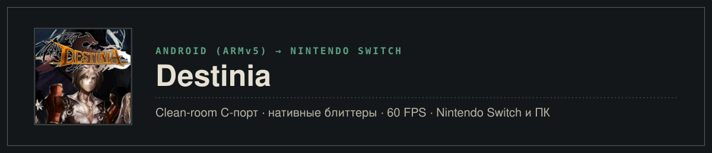
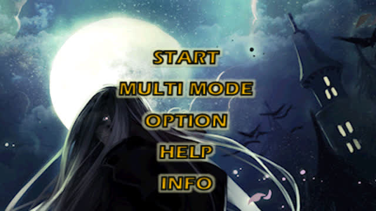
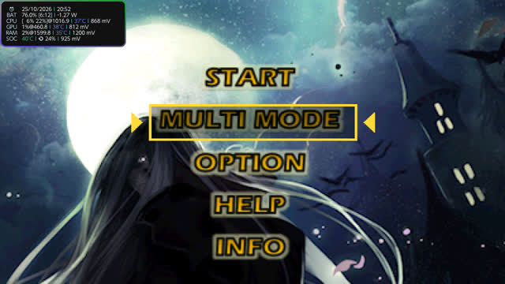
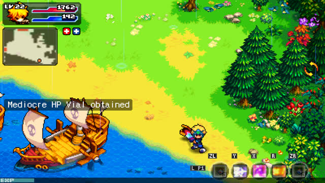
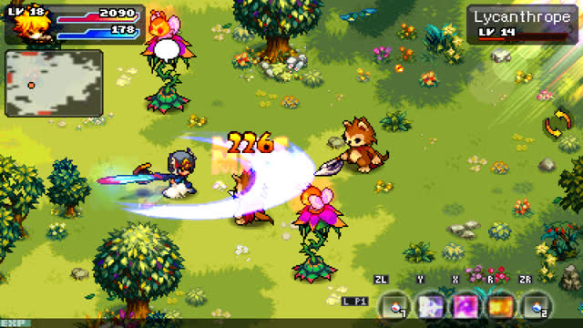
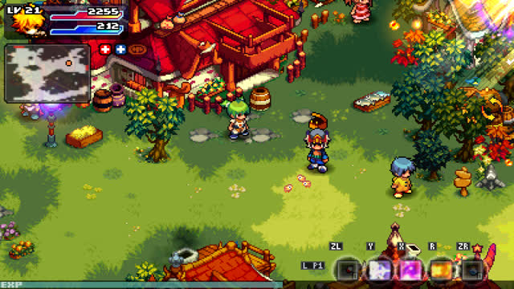
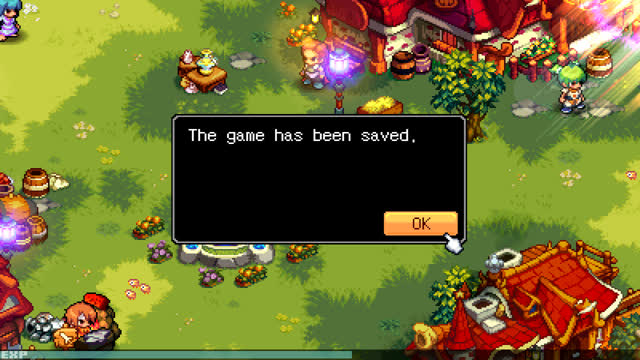
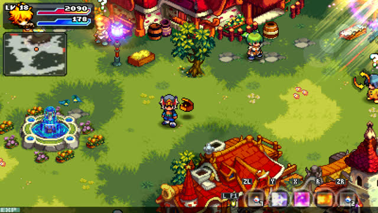
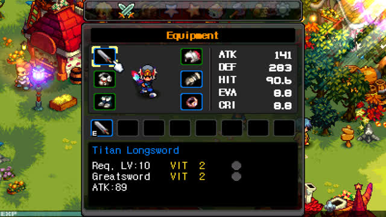

<p align="center">
  
</p>

<p align="center">
  <a href="README.md">English</a> · <b>Русский</b>
</p>

<p align="center">
  
</p>

Нативный чистый (clean-room) порт и слой совместимости классической Action RPG **Destinia** (GAMEVIL, 2011, v1.06) на Nintendo Switch и ПК.
Оригинальный ARMv5 Thumb бинарник (`libdestinia_jni.so`) исполняется напрямую через легковесный интерпретатор C с высокоуровневой эмуляцией (HLE) платформенных служб Android и JNI (вывод кадрового буфера, файловая система, потоковый звук, обработка ввода и тайминги). Критические участки рендеринга (блиттеры оружия, эффекты ауры, альфа-смешивание, затемнение экрана) заменены на оптимизированные нативные C-функции.

> [!IMPORTANT]
> **[Версия 1.0.0](https://github.com/malinkin-s/destinia-nx/releases/tag/v1.0.0)** — полный релизный билд. Протестирован на реальной консоли Nintendo Switch: стабильные 60 FPS в самых плотных боях, полноценное управление с геймпада, системная запись видеороликов и стриминг через SysDVR, а также полностью переработанная экономика за внутриигровое золото. Файлов игры в репозитории нет: требуется легально приобретённый файл `DESTINIA_v1_06.apk` (инструкция по установке ниже).

## Состояние

**Версия 1.0.0, 2026-10-25.** Замеры на Nintendo Switch на стандартных частотах (портатив, CPU 1020 МГц, GPU 384 МГц).

| Что | Switch | Подробности |
|---|---|---|
| Запуск, логотипы, меню | **Работает** | Стабильные 60 FPS, переключение вкладок меню на **L / R**, подсветка пунктов |
| Сюжетный режим и мир | **Работает** | Плавное перемещение, автоматическое возобновление бега после дэша и смены зон |
| Бои и применение умений | **Работает** | Стабильные 60 FPS, 0 просадок кадров при критах и визуальных спецэффектах |
| Интерфейс (HUD) и геймпад | **Работает** | Чистый консольный HUD, мобильные кнопки скрыты, двухстраничный хотбар **Hold L** |
| Сохранения на SD-карте | **Работает** | Бесшовное сохранение и загрузка через стандартную систему сохранений |
| Звук и музыка | **Работает** | Аппаратный вывод звука и музыки через SDL2_mixer без треска и артефактов |
| Запись видео и SysDVR | **Работает** | Нативная запись 30-секундных роликов кнопкой Capture (`video_capture = 2`) и стриминг через SysDVR |
| Special Shop и воскрешение | **Работает** | Донат заменён на внутриигровое золото, мгновенное воскрешение на экране смерти |
| Режим сна (сна/пробуждения) | **Работает** | Корректный уход в сон и сворачивание в HOME-меню с глушением звука |

### Что пришлось решить

- **Чистый C-интерпретатор ARMv5 Thumb и HLE**: Исполнение оригинального 32-битного бинарного движка на 64-битной Horizon OS (AArch64) и x86_64 ПК без задержек и оверхеда виртуальных машин Android.
- **Побитовая идентичность (`golden.sh`)**: Все нативные замены проверены регрессионным тестом на 700 кадров против эталонного эмулятора (`PASS: 700/700 frames identical`).
- **Нативные процедуры рендеринга**: Оптимизированные C-блиттеры (`Grp_drawWPNImage`, `_Grp_drawAura16`, `Grp_closeupScreen2`, `_Grp_drawDodgeCol16`) устранили спайки фреймтайма при битвах с толпами врагов.
- **Консольный редизайн HUD**: Мобильный виртуальный D-pad и сенсорные кнопки скрыты; круговой селектор заменён на 10-кнопочный горизонтальный хотбар с динамическими глифами (`[ZL], [Y], [X], [R], [ZR]` $\leftrightarrow$ `[L+ZL]..[L+ZR]`).
- **Удобство перемещения**: Направление аналогового стика автоматически перенажимает ходьбу после дэша и переходов между локациями (`resume_walk`).
- **Офлайн-экономика за золото**: Мобильный биллинг переведён на внутриигровое золото ([docs/economy.md](docs/economy.md)), покупка воскрешения после смерти работает безотказно.
- **Системная запись видео**: Включён флаг автоматического захвата геймплея (`video_capture = 2` в NACP), что открыло запись 30-секундных клипов в Альбом и стриминг через SysDVR.

## Скриншоты

Снято напрямую на Nintendo Switch (640×360), версия 1.0.0.

<table>
  <tr>
    <td></td>
    <td></td>
  </tr>
  <tr>
    <td align="center"><sub>Титульный экран</sub></td>
    <td align="center"><sub>Меню выбора режима</sub></td>
  </tr>
  <tr>
    <td></td>
    <td></td>
  </tr>
  <tr>
    <td align="center"><sub>Бой с консольным хотбаром</sub></td>
    <td align="center"><sub>Полевой бой</sub></td>
  </tr>
  <tr>
    <td></td>
    <td></td>
  </tr>
  <tr>
    <td align="center"><sub>Исследование мира</sub></td>
    <td align="center"><sub>Подземелье</sub></td>
  </tr>
  <tr>
    <td></td>
    <td></td>
  </tr>
  <tr>
    <td align="center"><sub>Сюжетный диалог</sub></td>
    <td align="center"><sub>Характеристики и экипировка</sub></td>
  </tr>
</table>

## Управление

### Перемещение и бой

| Кнопка | Действие |
| :--- | :--- |
| **Левый стик / Крестовина (D-Pad)** | Перемещение героя / Навигация в меню |
| **A** | Подтверждение / Атака / Взаимодействие / Разговор |
| **B** | Отмена / Меню персонажа (в поле) |
| **Минус (-)** | Открыть / закрыть мини-карту |
| **Плюс (+)** | Системное меню (Сохранение / Настройки) |
| **L / R** (в меню персонажа) | Переключение между вкладками меню |
| **Кнопка Capture** | Короткое нажатие — скриншот, удержание — запись видео 30 сек |

### Хотбар быстрых слотов

Слоты умений и предметов используют двухстраничную систему. Зажмите **L** для переключения на страницу 2:

| Кнопка | Страница 1 (Обычная) | Страница 2 (Удержание L) |
| :--- | :--- | :--- |
| **ZL** | Быстрый слот 5 (Зелье / Расходник) | Быстрый слот 10 (Второй расходник) |
| **Y** | Быстрый слот 1 (Боевой навык 1) | Быстрый слот 6 (Боевой навык 5) |
| **X** | Быстрый слот 2 (Боевой навык 2) | Быстрый слот 7 (Боевой навык 6) |
| **R** | Быстрый слот 3 (Боевой навык 3) | Быстрый слот 8 (Боевой навык 7) |
| **ZR** | Быстрый слот 4 (Боевой навык 4) | Быстрый слот 9 (Боевой навык 8) |
| **LS (Клик левого стика / L3)** | Быстрый слот 5 (Прямой доступ) | Быстрый слот 10 (Прямой доступ) |

## Установка и запуск

### Требования
- Консоль Nintendo Switch с кастомной прошивкой (**Atmosphère** 1.0.0+).
- Файл `DESTINIA_v1_06.apk` (оригинальная версия для Android от GAMEVIL, 2011).

### Настройка
1. Скачайте свежий релиз со страницы [Releases](https://github.com/malinkin-s/destinia-nx/releases).
2. Распакуйте архив на microSD карту, чтобы структура каталогов выглядела так:
   ```text
   sdmc:/switch/destinia/
   ├── destinia.nro
   └── DESTINIA_v1_06.apk
   ```

### Запуск

Игру можно запускать двумя способами:

1. **Через Homebrew Menu**: Запустите Homebrew Menu (удерживая **R** при запуске любой установленной игры для полного доступа к памяти, либо через Альбом) и выберите **Destinia**.
2. **Через Forwarder в HOME-меню (Рекомендуется)**:
   - Установите `Destinia [0100D3571A000000] [v0].nsp` (или `.nsz`) через DBI, Tinfoil, TinWoo или Sphaira.
   - Запускайте **Destinia** прямо из главного меню Switch, как обычную игру.
   - При выходе обновлений достаточно просто заменять `destinia.nro` на SD-карте.

## Сборка

### Nintendo Switch (.nro)

Сборка под Nintendo Switch выполняется в Docker с devkitPro `devkitA64`:

```bash
# Очистка
./tools/build_switch.sh clean

# Компиляция NRO (на выходе port/destinia.nro)
./tools/build_switch.sh -j$(nproc)

# Сборка форвардера NSP / NSZ
./tools/build_forwarder.sh

# Упаковка релиза zip
./tools/package.sh 1.0.0
```

### ПК (Linux / macOS)

Требуются: GCC/Clang, SDL2, zlib, libm.

```bash
# Сборка десктопного бинарника
make -C port -j$(nproc)

# Запуск игры
./port/destinia --apk DESTINIA_v1_06.apk
```

### Регрессионное тестирование (Golden Frames)

Для проверки побитовой точности против эталона:

```bash
./port/tests/golden.sh DESTINIA_v1_06.apk
```

## Благодарности

- **Оригинальная игра**: GAMEVIL Inc. (ныне Com2uS Holdings).
- **Порт на Nintendo Switch и реверс-инжиниринг**: [malinkin-s](https://github.com/malinkin-s) и контрибьюторы.
- **Вдохновение и ориентир**: aks796 ([a8retry_nx](https://github.com/aks796/a8retry_nx), android32).
- **Библиотеки и инструментарий**: [devkitPro](https://devkitpro.org/) (devkitA64, libnx), [libSDL2](https://www.libsdl.org/), SDL2_mixer.

## Лицензия и отказ от ответственности

MIT, см. [LICENSE](LICENSE). Это фанатский проект, не связанный с GAMEVIL, Com2uS Holdings или Nintendo. *Destinia* и все связанные персонажи и товарные знаки принадлежат их правообладателям. **В этом репозитории не распространяются защищённые авторским правом файлы игры, бинарные библиотеки или ассеты.**
